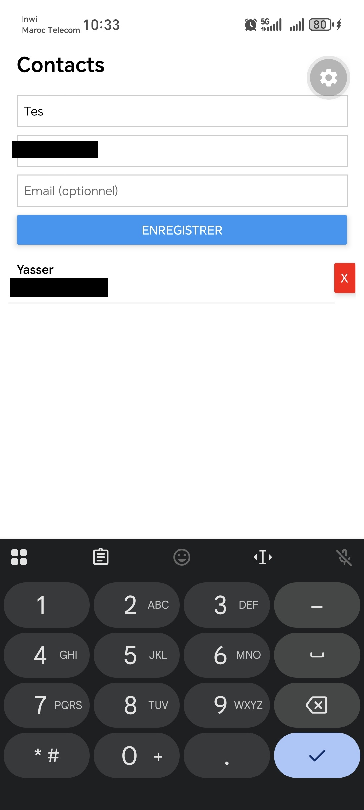

# Lab 13 — Gestion de contacts avec SQLite

Saisie du nom et du numéro d’un nouveau contact.

Le nouveau contact apparaît dans la liste après l’enregistrement.

La liste se met à jour après la suppression du contact ajouté.

